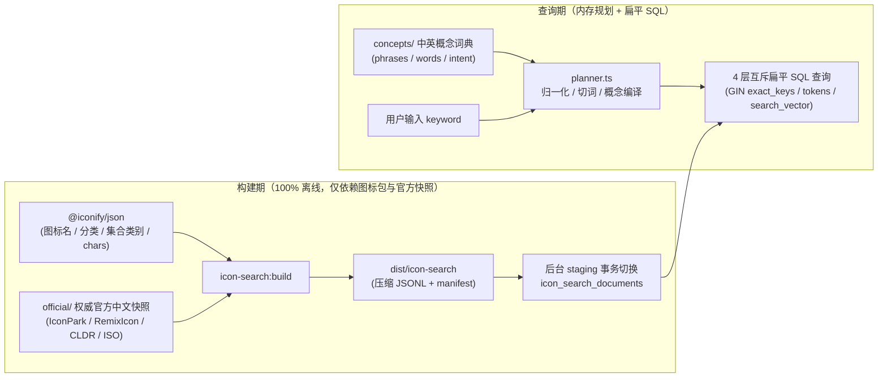

# 图标中文搜索重构设计：查询侧概念映射与官方中文直出

## 1. 背景、目标与非目标

### 背景与重构原因

后台图标选择器与内容管理图标库共用搜索服务。锁定的 `@iconify/json` 包含 238 个图标集和 420,720 个图标 ID。多个集合使用相同的英文名称，逐图标维护中文写法会重复编写和审校同一概念。[上一版图标搜索设计](./2026-09-13-icon-search-design.md)

旧译表按单词拆译复合名称，导致搜“日志”会匹配 `log-out`，搜“罐头”会匹配 `trash-can`。本设计用查询侧词典跨集合复用中英映射，用书写规则处理“四级标题”和“标题级别4”等变体，在索引中保留各图标集自己的官方中文标题与标签。

### 目标

1. **改善常用中文查询**。在现有单实例 Node.js + PostgreSQL / PGlite 架构内，通过查询侧概念映射、书写规则及上游中文数据，提高常用查询的首屏命中，减少旧译表造成的误关联。
2. **后台核心体验达标**。用户输入对象、动作、状态或用途关键词时，应能在前 12 项中找到合适的图标。首个切题图标的位置用于衡量它是否容易找到。主力集合的直接含义排在主力用途推荐之前，两者都可排在非主力集合的结果前。
3. **改词典零索引重建**：概念词典加载在服务端内存中完成编译，日常增删改中文概念词条只需更新查询规则版本并重启，无需重建 42 万行数据库索引。
4. **保持现有行为与契约稳定**。完整 ID、包内英文原名和别名、逐图标分类、集合信息及用户填写的关键词沿用现有英文匹配与排序规则。受限前缀只用于长度至少为 2 的纯字母词。仅由旧中文译文带入的英文、数字及字母数字词项随译表移除。来源与图标集筛选、空查询推荐、两个入口的一致性以及公开 HTTP 契约沿用现有行为。

### 非目标

- 不引入 embedding 向量检索、重排模型或运行时大模型调用。
- 不对 42 万个图标逐个编写或核验静态中文译文；直接移除现有 90 MB 译表与逐图标生成验收脚手架。
- 用户能轻松找到切题选项时，首屏可以包含同名异义图标。品牌、编程、Emoji、国旗与通用 UI 之间的歧义按集合类别规则处理。
- 不引入重型通用中文分词库、拼音检索、拼写纠错或简繁体互搜；内置与官方中文统一使用简体中文。
- 不修改自定义图标的数据模型与关键词输入上限。

---

## 2. 整体架构与数据流

新架构将“构建事实索引”与“理解中文查询”彻底拆分为两条正交链路，移除原有的递归 CTE 与位掩码路径图引擎：



### 双版本号解耦

为使“修改中文概念词典不触发 42 万行数据库索引重建”，将原来单一的规则版本号拆分为职责独立的两套版本标识：

| 版本标识 | 参与计算的要素 | 写入位置 | 变更影响 |
| --- | --- | --- | --- |
| `indexRulesVersion` | 索引文档派生逻辑、原词序 `tsvector` 构造、`category` 映射表、[rules.ts](../../apps/server/src/modules/icons/search/rules.ts) 中的 `preference` 权重及官方中文注入规则 | 产物 `manifest.json`（[schema.ts](../../apps/server/src/modules/icons/search/artifacts/schema.ts)，`formatVersion` 升级为 `6`）与数据库状态表 `icon_search_index_state` | 仅当 `indexRulesVersion`、图标包版本或 `official/` 快照变化时，才触发后台重建 42 万行索引 |
| `queryRulesVersion` | 查询切词/归一化规则、Tier 0～3 排序规则以及 `concepts/` 全部 JSON 文件的内容指纹 | 关键词搜索的分页游标，见 [cursor.ts](../../apps/server/src/modules/icons/cursor.ts) | 更新概念词典后，旧搜索游标失效，数据库复用现有索引 |

---

## 3. 数据库索引表重设计

通过一次正向 Drizzle 迁移演进 [schema.ts](../../apps/server/src/db/schema.ts) 中的 `icon_search_documents` 与 `icon_search_documents_staging`：

1. **移除旧表达列与索引**。删除 `full_expressions`、`primary_expressions`、`exact_expressions` 三列，以及对应的 `*_full_expressions_gin` 索引。
2. **演进原有数组列与索引**。将 `exact_phrases` 重命名为 `exact_keys`，将 `full_tokens` 重命名为 `tokens`，保留 `primary_tokens`。另设 `related_tokens` 存官方相关标签。两张表均为 `name` 建独立 B-tree 索引，供精确英文名及用途名匹配，并将该索引纳入 staging 交换及重建流程。
3. **新增 `category` 列**。`text NOT NULL` 并附加 `CHECK` 约束，将 `@iconify/json` 的集合分类映射为下表中的 7 个枚举值。多义词仅靠英文推断命中时，可据此降低其排序。

| `category` 枚举值 | 数据来源（`collections.json` 的 `category` 或来源类型） |
| --- | --- |
| `ui` | `Material`、`UI 24px`、`UI 16px / 32px`、`UI Other / Mixed Grid`、`UI Multicolor` |
| `brand` | `Logos` |
| `programming` | `Programming` |
| `emoji` | `Emoji` |
| `flag` | `Flags / Maps` |
| `other` | `Thematic`、`Archive / Unmaintained` 及未声明分类的内置集合 |
| `custom` | 用户自定义图标 |

4. **升级 `search_vector` 以保留英文原名词序**：改变当前 [rebuild.ts](../../apps/server/src/modules/icons/search/indexing/rebuild.ts) 将英文词项按字母排序去重后再喂给 `to_tsvector` 的做法。改按以下结构构造 `search_vector`：
   - **权重 `A`（主名称向量）**：将规范化后的图标原名按英文/数字边界连字符与斜杠替换为单个空格，保持原始顺序与重复位置直接生成 `setweight(to_tsvector('simple', primary_name_text), 'A')`（例如 `log-out` 生成 `'log':1A 'out':2A`，`heading-4` 生成 `'heading':1A '4':2A`）。
   - **权重 `B`（自定义关键词）**。来自用户填写的英文关键词，保留现有完整词和纯字母前缀匹配。例如名称为 `badge`、关键词为 `finance` 的自定义图标可以通过 `fina` 找到。英文名称相邻短语只查权重 `A`，以免将名称末尾和关键词开头拼成一个短语。
   - **权重 `C`（逐图标分类）**。提取上游明确分配给该图标的分类中的英文及字母数字词项。
   - **权重 `D`（图标集）**。提取集合名称和 prefix 的英文及字母数字词项，供用户直接输入这些词时匹配，如 `lucide 登出` 中的 `lucide`。
   - **效果**：PostgreSQL 原生短语操作符 `log:A <-> out:A` 可直接精确匹配相邻复合词，且 `NOT (search_vector @@ to_tsquery('simple', 'log:A <-> out:A'))` 可精准排除误撞车复合词，同时不会跨名称与辅助字段误拼接位置。

### 核心检索列职责定义

| 列名 | 类型与索引 | 写入内容 |
| --- | --- | --- |
| `category` | `text NOT NULL` | 上述 7 个集合类别枚举值之一 |
| `exact_keys` | `text[] NOT NULL` + GIN | 完整归一化英文原名（如 `log-out`）、官方中文完整标题原文及其去空规范键（如 `k线图`）、自定义图标完整关键词及其去空规范键 |
| `tokens` | `text[] NOT NULL` + GIN | 英文/数字字面词项、官方中文标题、自定义图标关键词、包内分类词项、prefix 与集合词项 |
| `primary_tokens` | `text[] NOT NULL` + GIN | `tokens` 中来自图标自身名称、官方中文标题或自定义图标关键词的部分 |
| `related_tokens` | `text[] NOT NULL` + GIN | 上游提供的中文搜索标签或 Emoji 注释关键词。保留每条标签及其规范键，作为 Tier 2 的相关结果依据 |
| `name` | `text NOT NULL` + B-tree | 完整原名，支持 `name = ANY(...)` |
| `search_vector` | `tsvector NOT NULL` + GIN | 图标英文原名用 `A`，自定义关键词用 `B`，逐图标分类用 `C`，集合名称和 prefix 用 `D` |
| `english_rank_vector` | `tsvector NOT NULL` | 复用原英文排序的派生方式。名称与自定义关键词的纯英文字词去重排序后用 `A`，其余分类、前缀与集合英文词去重后用 `B`。纯英文查询按这些词判定前缀匹配并打分，候选可用前述 GIN 索引预筛 |

---

## 4. 维护资源与数据来源

新版本移除现有的 `apps/server/resources/icon-search/translations/` 目录。查询词典与官方中文快照按以下结构维护，分别统计占用空间。

```text
apps/server/resources/icon-search/
├── README.md
├── manifest.json          # 资源格式版本、词典版本、官方快照来源元信息与 SHA-256
├── concepts/              # 查询侧中英概念词典（运行时加载内存）
│   ├── phrases.json       # 有实际查询依据的完整短语、动作与状态
│   ├── words.json         # 常用查询需要的对象和组成词
│   └── intent.json        # 后台用途推荐
└── official/              # 构建期离线官方中文快照（零模型参与）
    ├── icon-park.json     # ByteDance IconPark 官方标题与标签裁剪快照
    ├── remix-icon.json    # RemixIcon 官方中文标签裁剪快照
    ├── cldr-emoji.json    # Unicode CLDR 简体中文 Emoji 注释快照
    └── iso-flags.json     # Unicode CLDR / ISO 3166-1 简体中文国家/地区表快照
```

### 4.1 查询侧中英概念词典（`concepts/`）

正式首版词典规划约 **3,650～5,300 条概念记录**。总数和以下三个文件的分项条数仅用于估算编制与审校工作量。词典按第 8.1 节的固定回归用例和第 8.2 节的首屏命中率验收。

一条记录可以包括多个中文同义词和英文名称。例如“登出”和“退出登录”共用一条记录，对应 `logout`、`log-out`、`sign-out`，适用于使用这些名称的各个图标集。

- `words.json` 约 2,500～3,500 条，收录“文件夹”“蓝牙”等可以独立查询或参与组合的基础词。
- `phrases.json` 约 1,000～1,500 条，收录复合对象、动作与状态，如“打开文件夹”“退出登录”“圆底烧瓶”。
- `intent.json` 约 150～300 条，收录从用途联想到图形的常见关系，如“通知”对应 `bell`，“删除”对应 `trash` 或 `bin`。用途单独维护，便于调整排序。

#### 概念条目字段约定

```json
{
  "zh": ["日志"],
  "en": ["logs", "audit-log"]
}
```

| 字段 | 约束与语义 |
| --- | --- |
| `zh` | 必填，非空简体中文同义词数组，可含字母数字，如 `k线图`、`avi文件`。加载时归一化并去除汉字间及中英混排空白。同一条记录列出的中文写法共享英文目标，也能互相匹配自定义关键词、官方中文标题及标签 |
| `en` | 可选字符串数组，直接等义英文词或连字符短语（如 `log-out`、`trash-can`、`settings`）；短语在编译时保留词序，单词不自动开启前缀通配 |
| `exactNames` | 可选字符串数组，直接等义的完整图标原名。适用于容易和绘制样式混淆的词，例如“粗体”的 `bold` 匹配 `lucide:bold`。每个目标必须存在于锁定图标包的名称或别名中 |
| `intentEn` | 可选字符串数组，后台用途延伸英文词或短语；仅允许命中 Tier 0 用途分与 Tier 2 |
| `exclude` | 可选字符串数组。在该概念的英文推断分支中排除指定的词项或短语。例如“罐头”可排除 `trash-can`、`garbage-can` 和 `watering-can` |
| `demoteCategories` | 可选。在指定集合大类中，仅靠该概念的英文推断命中的候选降至 Tier 2。例如“鼠标”在 Emoji 集合中降权，“烧瓶”在品牌和编程集合中降权。类别本身始终保留候选。官方中文标题、自定义关键词和官方相关标签按各自的证据参与排序 |
| `parts` | 短语可选。显式列出允许组合的已有基础概念键，如“打开文件夹”允许“打开”与“文件夹”同时匹配。省略时按整词匹配；组成词只引用基础概念 |

校验与合并规则：
- 每条记录的 `en`、`exactNames` 和 `intentEn` 至少有一项非空。
- **同一文件内中文键必须唯一**，重复直接报错。
- 若不同文件的记录共用一个规范化中文键，两条记录的 `zh` 必须包含完全相同的规范化写法，顺序可以不同。部分重叠时报错并列出两组写法。组内所有写法共享合并去重后的 `en`、`exactNames`、`intentEn`、`exclude`、`demoteCategories` 和短语声明的 `parts`。含义不同的词可以分别声明相同的用途目标。
- **初版词典的编制**。从锁定图标包提取高频基础词和跨集合短语，结合用户在后台图标选择器或图标库中查找菜单图标、按钮图标或状态图标时使用的中文搜索词编制词条。英文词频用于发现候选词。分三类记录定稿条数、编制和审校耗时，以及辅助生成使用的 token 数。
- 替换旧译表之前，以相同的图标集筛选复测旧版能命中的常用对象，如“服务器”和“蓝牙”。当 `log` 或 `can` 等多义词把切题图标挤到后面时，优先用含义明确的复合名称或所属图标集的官方中文改善排序。
- 复合用途词按整条查询选择英文目标。例如“屏幕共享”的直接名称有 `screen-share` 和 `share-screen`，“设置密码”可推荐锁配齿轮的 `lock-cog`。仅因组成词都出现而得到的候选需核对图义，例如“部门设置”不采用网络信号设置图标。

### 4.2 索引侧官方权威中文快照（`official/`）

为覆盖英文名本身难以反映中文含义的特例（如 `icon-park-outline:block-seven` 为“俄罗斯方块”、Emoji 名称及两位国家码国旗），在构建期接入 4 份确定性权威快照，**全部零模型成本、仅作用于各自所属图标集，不跨集合盲目推广**：

| 快照文件 | 匹配键与来源图标集 | 写入索引字段 |
| --- | --- | --- |
| `icon-park.json` | ByteDance IconPark 官方 `icons.json`，以基础名精确匹配 `icon-park`、`icon-park-outline`、`icon-park-solid`、`icon-park-twotone` | 中文标题进 `exact_keys` 与主词项，标签进 `related_tokens` |
| `remix-icon.json` | RemixIcon 官方 `tags.json`，去除 `ri` 名称末尾的 `-line` 或 `-fill` 后按基础名关联 | 中文标签进 `related_tokens`。例如 `file` 的“新建”是用途关联 |
| `cldr-emoji.json` | Unicode CLDR 简体中文 `annotations` 与 `annotationsDerived`，通过图标包 `chars` 逐码点序列匹配有映射的 Emoji 集合 | 官方短名称进 `exact_keys` 与主词项，注释关键词进 `related_tokens` |
| `iso-flags.json` | 来自 Unicode CLDR / ISO 3166-1 简体中文国家/地区名称；按规范两位区域码（兼容去除 `-1x1`、`-4x3` 等画布后缀及 `cif` 前缀形态）精确匹配 `flag`、`circle-flags`、`flagpack`、`cif` | 官方中文名称及常用简称进 `exact_keys` 与 `primary_tokens` |

设计约定：
- 构建期通过统一的可插拔适配器接口读取 `official/`；后续若确认其他集合（如 Ant Design / Element Plus / TDesign）存在高质量、结构化的官方中文清单，只需新增快照与适配器并记录进 `manifest.json`，无需改动检索与查询引擎。
- 项目根目录的 `pnpm deps:update` 先调用 `pnpm -r update`，成功后运行 TypeScript 维护工具在本地检查官方数据。三个上游独立发版，每次维护依赖都检查，即使图标包版本相同。IconPark 跟踪主分支提交，RemixIcon 和 Unicode CLDR 跟踪正式版本。
- 上游中文数据有变化时，在本地缓存生成并校验 Git 补丁，包含官方快照、固定到提交的来源与校验和以及对应的上游许可声明。维护者审阅、应用并与依赖更新一起提交。发布构建使用仓库内快照，完全离线。

---

## 5. 查询解析、SQL 编译与分层排序

### 5.1 完整 ID 直通

输入规范化后若匹配 `completeIconIdSchema`（合法 `prefix:name`，如 `lucide:log-out`、`lucide:trash-2`），直接沿用现有逻辑按 `id = ${phrase}` 精确查询单条记录，不经过概念解析与分层排序。

### 5.2 查询解析管线（`planner.ts`）

对于非完整 ID 的非空查询，在内存中按顺序执行以下确定性步骤：

1. **基础归一化与整串去空键**：调用 [search-text.ts](../../packages/utils/src/search-text.ts) 的 `normalizeSearchText` 完成 NFKC、小写与空白折叠；构造整串去除汉字之间及中英混排空白后的规范键 `compactKey`（例如 `打开 文件夹` → `打开文件夹`，`K 线图` → `k线图`），优先检查整串是否命中概念词典或作为官方/自定义完整标题键。
2. **中/英/数字边界自动切分**。按空白识别输入片段，再按汉字、连续 ASCII 字母与数字的边界切分，如 `AVI文件` 可拆成 `avi` 和“文件”。连字符或斜杠分隔的纯 ASCII 词组按原规则拆分。含中文的片段若被拆成多个条件，保留该片段完整的规范化写法，供第 5.3 节按原文匹配。
3. **确定性数字/级别模式归一**：在概念切词前，对明确的中文序数/级别组合模式做规则归一化（例如将 `一～六` 与 `1～6` 的 `[一二三四五六1-6]级标题`、`标题(?:级别)?([1-6])` 统一归一化为语义序列 `["标题", "<n>"]`，并附加精确短语候选 `heading-<n>`、`h-<n>`、`h<n>`），从而使 `四级标题`、`4级标题`、`标题4`、`标题级别4` 无需离线穷举即可互通。
4. **基于概念词典的正向最长匹配切词**：
   - 对连续中文段使用内存中的概念词典（`phrases + words + intent` 合并键集）执行正向最长匹配。
   - 两侧都识别为概念时可跳过连接字“的”，例如“打开的信封”。“已”结合动作或状态匹配相应词条，例如“已打开”可以与“打开”共用图标，“已读”与“未读”仍各自匹配。
   - 短语声明了 `parts` 时，优先匹配完整短语，也允许所有指定组成词同时满足。“信用卡”“不可见”等整词独立匹配。
   - 未识别的连续片段整体保留为字面条件，可匹配直接中文词项或较低层级的官方标签；各个用户条件均须满足。
5. **纯英文输入隔离与复杂度上限**：
   - 纯英文与 ASCII 字母数字输入沿用已有的完整名称、完整词项、受限前缀顺序和字母数字词边界。继续对 `english_rank_vector` 用原有的带前缀 AND 查询计算 `ts_rank`，再比较集合偏好和 ID。英文兼容基线仅使用上述包内字段和自定义关键词。例如删除“IE 浏览器”这条旧译文后，`cib:internet-explorer` 仍可用原名查到，`ie` 不再由旧译文命中它。基于该兼容范围验证 `file` 的前 60 项顺序、`sign` 后续页的 `signpost` 与 `3d` 的完整匹配。
   - 继续遵守公开契约的最大长度限制（`ICON_SEARCH_KEYWORD_MAX_LENGTH = 120`）。按输入顺序，前 8 个不同语义单元允许字面匹配或概念展开，之后的单元按字面匹配。切词匹配要求所有单元都满足。

### 5.3 SQL 编译规则

各输入片段用 **AND** 连接。对被拆成多个条件的中文片段，额外用一次原文条件查现有的完整键和相关标签索引。例如 `acme 日志通知` 要求 `acme` 匹配，同时满足以下任一条件：“日志通知”完整命中该图标的自定义关键词、官方标题或相关标签，或“日志”和“通知”两个单元都匹配。原文命中沿用相应字段的层级。每个片段只产生一个额外条件，无需枚举子串或组合切法。

含中文的查询按用户输入的空白划分各段。如果每段的规范键都对应同一个自定义图标的完整关键词，该图标以 Tier 0 的 2 分参与排序。例如“菜单 管理”可以同时找到填写完整“菜单管理”的图标（3 分）、分开填写“菜单”和“管理”的图标（2 分）与主力集合中的整词用途图标（2 分）。输入“菜单管理”时仍按整词检索。混合查询中的英文段如果恰好等于图标名，也须有对应的自定义关键词才能通过这条规则。

单个语义单元按下表匹配。

| 单元类型 | 匹配条件 | 排除与降权 |
| --- | --- | --- |
| 命中概念词典的中文单元 | 当前中文键及同一词条 `zh` 中的同义词，任一命中 `tokens` 或 `related_tokens` 即可。也可通过该概念的 `en`、`exactNames` 或 `intentEn` 英文分支命中 | `exclude` 排除有明确词项证据的错误推断，`demoteCategories` 调整该单元英文推断的层级。字面中文和标签分别按其来源参与排序 |
| 未命中词典的字面中文单元 | 直接词项查 `tokens`，相关标签查 `related_tokens` | 无 |
| 数字/符号/单字符单元 | `tokens @> ARRAY[词项]::text[]` | 无 |
| 纯英文词单元（长度 $\ge 2$ 字母） | 精确部分 `tokens @> ARRAY[词项]` / `search_vector @@ '词项'`；前缀部分 `search_vector @@ '词项:*'` | 无 |

中文同义词只取自词典中明确与当前写法同组的 `zh`。例如搜“登出”可以匹配只填写了“退出登录”的自定义图标。用同义词命中自定义关键词或官方中文标题，按直接词项计入 Tier 1；命中官方相关标签则计入 Tier 2。原查询或其去空规范键与完整标题、关键词相同时，仍按 Tier 0 精确命中计分。

其中概念中的英文目标写法遵循统一转译规则：
- 带连字符的短语（如 `log-out`、`trash-can`、`credit-card`）编译为有序相邻向量 `to_tsquery('simple', 'log:A <-> out:A')`。
- 中文概念推导的单个英文目标（`en`、`intentEn`）只在图标名、逐图标分类和自定义关键词中精确匹配，如 `file:ABC`。候选与排序使用相同的字段限制。`bell` 与 `bells` 需在词典中分别列出。用户直接输入的英文词按原规则查所有字段，包括图标集名称和 prefix。
- `exactNames` 通过 `name = ANY(...)` 匹配完整名称，适用于单独查询、组合条件和声明的 `parts`。整名证据计入直接命中的层级和主字段命中数，词项相关度 `ts_rank` 仅由允许词项匹配的英文条件计算。
- `exclude` 中的单个英文词在图标原名和上游为该图标分配的分类中匹配（权重 `AC`）。用户填写的关键词（权重 `B`）只提供正向匹配。连字符短语只在图标名中按原词序相邻匹配，例如“罐头”排除 `trash-can` 时使用 `NOT (search_vector @@ to_tsquery('simple', 'trash:A <-> can:A'))`。

### 5.4 四级互斥分层（Tier 0～3）、排序元组与分页游标

以下四层用于含中文的查询。纯英文按 5.2 的原排序规则检索，游标仍绑定查询规则版本与索引版本。含中文查询按 `tier = 0 → 1 → 2 → 3` 依次执行互斥查询，累计拿到 `limit + 1` 条记录即提前终止后续层级。

| 层级 | 定义与准入条件 | `match_score` 计算方式 |
| --- | --- | --- |
| **Tier 0（精确完整命中）** | 整条查询或其 `compactKey` 命中 `exact_keys`，所有显式空格分段分别命中同一个自定义图标的完整关键词，或原名精确匹配整串概念的 `en`、`exactNames` 或 `intentEn`（`name = ANY(...)`）。英文推断须通过该概念的排除规则，降权的推断在 Tier 2 参与。取图标可用的最高分 | 用户填写的完整关键词精确命中，与主力集合的直接精确命中（含官方标题）同为 3 分。所有显式分段精确命中自定义关键词或主力集合用途精确命中为 2 分。其余直接精确命中为 1 分，其余用途精确命中为 0 分 |
| **Tier 1（直接词义完整命中）** | 其余结果中，所有条件均可由直接词项、英文完整词或未降权的 `en`、`exactNames` 满足 | 命中名称、自定义关键词或直接主词项的单元数降序 |
| **Tier 2（相关命中）** | 其余结果中，所有条件均满足，至少一项需要官方相关标签、用途延伸或降权的英文推断。例如“新建”仅通过 RemixIcon 的相关标签命中普通文件图标 | 直接主字段命中单元数降序 |
| **Tier 3（中英混搜中的英文前缀匹配）** | 其余结果中，所有查询条件均满足，至少一个用户输入的纯英文字母词（长度 ≥ 2）依靠 `term:*` 前缀匹配。搜 `luc 登出` 时，`luc` 匹配集合标识 `lucide` 的开头，“登出”匹配 `log-out`，可找到 `lucide:log-out` | 命中主字段的完整条件数 |

主力集合沿用 `preferredIconPrefixes` 中的 `lucide`、`tabler`、`heroicons`、`ph` 和 `material-symbols`。搜“通知”时，主力集合中名称为 `notification` 或 `notifications` 的图标优先。`lucide:bell` 等主力用途图标应进入前 12 项，并排在其他集合的同名 `notification` 图标之前。[排序规则](../../apps/server/src/modules/icons/search/rules.ts)

#### 统一排序元组与游标

所有层级共用同一 5 元排序键：

```text
ORDER BY tier ASC, match_score DESC, rank DESC, preference DESC, id COLLATE "C" ASC
```

含中文查询在 `tier` 和 `match_score` 相同时比较 `rank`。有英文查询分量时取 `ts_rank(search_vector, combined_en_tsquery, 0)`，同一个英文词在自定义关键词中的命中权重高于逐图标分类。无英文查询分量时取 `0::real`。纯英文按 5.2 的完整名称、完整词、前缀顺序填入层级，`match_score` 为 0，使用独立的 `english_rank_vector` 沿用原英文打分。两条路径的 `preference` 均沿用 `getIconPreference`。

[cursor.ts](../../apps/server/src/modules/icons/cursor.ts) 同步演进：
- 游标位置字段由 `(level, primaryMatches, rank, preference, id)` 更新为 `(tier, matchScore, rank, preference, id)`。
- 关键词搜索的游标通过 `rulesVersion` 绑定 `queryRulesVersion`，通过 `dataVersion` 绑定数据库已提交的 `indexVersion`。数据和规则一致时，按同一顺序翻页，无重复、无遗漏。版本变化使游标失效时，沿用现有流程，从第一页重新获取。
- 按 ID 浏览图标库时，游标记录图标来源、图标集筛选和上一页最后一个 ID。内置图标另绑定图标包版本。读取旧浏览游标时忽略其中的 `rulesVersion`，词典或搜索规则更新后仍可继续翻页。

---

## 6. 模块职责与清理清单

| 操作 | 路径 | 职责与说明 |
| --- | --- | --- |
| **删除** | `apps/server/resources/icon-search/translations/` | 移除 90 MB 旧逐图标译表目录 |
| **删除** | [expression-repository.ts](../../apps/server/src/modules/icons/search/expression-repository.ts)、[han-query.ts](../../apps/server/src/modules/icons/search/han-query.ts)、[query.ts](../../apps/server/src/modules/icons/search/query.ts) | 移除递归 CTE、位掩码路径图与旧表达检索代码 |
| **删除** | `apps/server/scripts/icon-search/quality/` 及对应测试夹具和用例 | 移除旧版逐图标中文表达的生成与核验工具 |
| **新增/重构** | `apps/server/resources/icon-search/` | 保留 `README.md` 与新版 `manifest.json`，新增 `concepts/{phrases,words,intent}.json` 与 `official/{icon-park,remix-icon,cldr-emoji,iso-flags}.json` |
| **新增/重构** | `apps/server/src/modules/icons/search/concepts.ts` | 启动加载 `concepts/`，执行 schema/唯一性校验、跨文件合并与 `queryRulesVersion` 计算 |
| **新增/重构** | `apps/server/src/modules/icons/search/planner.ts` | 纯函数查询解析器：归一化、边界切分、数字/级别模式归一、词典最长匹配切词与查询结构生成 |
| **重构** | [repository.ts](../../apps/server/src/modules/icons/search/repository.ts)、[document.ts](../../apps/server/src/modules/icons/search/document.ts)、[text.ts](../../apps/server/src/modules/icons/search/text.ts)、[rules.ts](../../apps/server/src/modules/icons/search/rules.ts) | 实现 4 层互斥扁平 SQL 查询、新版文档派生（保留词序向量与 `category` 映射）及双版本号分离 |
| **重构** | [schema.ts](../../apps/server/src/db/schema.ts) + 新建 Drizzle 正向迁移 | 演进 `icon_search_documents` 与 `icon_search_documents_staging` 结构与索引 |
| **重构** | `apps/server/src/modules/icons/search/artifacts/`、`apps/server/src/modules/icons/search/indexing/`、`apps/server/scripts/icon-search/build/`、`apps/server/scripts/icon-search/official/` | 升级产物 schema 至 `formatVersion = 6`，实现离线构建、官方中文注入，以及本地查新与补丁生成 |
| **同步** | [cursor.ts](../../apps/server/src/modules/icons/cursor.ts) | 更新 5 元排序游标与 `queryRulesVersion` 绑定 |
| **不变** | [packages/contracts/src/icons.ts](../../packages/contracts/src/icons.ts)、[search-text.ts](../../packages/utils/src/search-text.ts)、前端图标选择器与图标库 | 保持公开 API 契约、前端界面与两入口共用机制不变 |

---

## 7. 构建、生命周期与错误处理

### 校验与构建命令

- `icon-search:validate`：
  - 校验 `concepts/{phrases,words,intent}.json` 格式、必填字段、同文件中文键唯一性和跨文件同义词组一致性。
  - 按查询可匹配的字段，在当前锁定的图标包中验证 `en`、`intentEn` 和 `exclude` 的目标。只出现在集合名或 prefix 中的词不能验证为有效的概念目标。
  - 在图标包的完整名称和别名中逐一验证 `exactNames`。
  - 校验 `official/` 下各官方快照文件及 `manifest.json` 中的 SHA-256。
- `icon-search:build`：
  - 先运行上述校验；完全离线读取锁定 `@iconify/json` 与 `official/` 快照，计算 `indexRulesVersion`、`contentFingerprint` 与 `indexVersion`，输出压缩 JSONL 产物到 `apps/server/dist/icon-search`（不纳入 Git）。
  - 源码运行时直接读取 `resources/icon-search/concepts`。发布构建将三份词典复制到索引产物的 `concepts` 子目录，打包后的服务从该目录加载，入口改名或拆包后沿用同一位置。
  - 替换旧产物前逐条回读生成的分片，校验完整性、记录计数和 manifest 校验和。

### 索引生命周期与故障语义

沿用 [lifecycle.ts](../../apps/server/src/modules/icons/search/indexing/lifecycle.ts) 与 [rebuild.ts](../../apps/server/src/modules/icons/search/indexing/rebuild.ts) 的后台异步构建与 staging 事务整体切换机制：
- 仅在已提交的 `icon_search_index_state` 与当前 `installedIconPackageVersion` 及 `indexRulesVersion` 一致时，允许旧索引在后台更新期间继续服务。
- 当 `indexRulesVersion` 发生升级（例如本次迁移上线）时，旧索引不兼容，搜索返回“图标搜索正在准备”；若构建/导入失败，反馈“图标搜索暂不可用”，不静默回退到旧规则。
- 仅维护 `concepts/` 词典时，`indexRulesVersion` 保持不变，服务重启即复用现有数据库索引。
- 构建时词典校验失败即中止，服务启动时词典加载失败则沿用“图标搜索暂不可用”的提示。
- 运行时数据库查询失败时向上报告错误。查询正常完成且确实没有匹配项时返回空列表，保留用户输入的全部条件。

---

## 8. 验收标准与测试计划

### 8.1 固定中文回归集（50～80 条）

在仓库测试中固定 **50～80 条中文查询**，用正式词典和全量 PGlite 索引验收，覆盖以下六类场景。

1. **后台高频菜单与操作（约 25～35 条，前 12 项内命中切题图标）**：用户、角色、部门、菜单、权限、设置、退出登录、登出、日志、搜索、查找、删除、编辑、新增、上传、下载、刷新、导入、导出、公告、数据字典、附件、定时任务、监控、仪表盘、文件夹、锁/解锁、收藏、过滤/筛选等。
2. **用途词首屏分层验证（约 5～8 条）**：
   - 搜 `通知`：前 12 项同时出现直译图标（如 `notification` 系列）与主力用途图标 `lucide:bell`；
   - 搜 `删除`：前 12 项同时出现 `delete` 系列与主力用途图标 `lucide:trash` / `lucide:trash-2`；
   - 搜 `首页`：前 12 项覆盖 `home` 与 `lucide:house`。
   - 在 Fluent 中搜“共享屏幕”可找到 `share-screen-20-regular`，排除停止共享的 `share-screen-stop` 系列。在 Tabler 中搜“设置密码”可找到 `lock-cog`。“添加备注”可找到便笺图标，排除仅表示添加音符的名称。
3. **写法变体互通（约 8～12 条）**：`打开文件夹` / `打开 文件夹` / `打开的文件夹`（命中 `folder-open` 等）；`K线图` / `K 线图` / `股票图`；`四级标题` / `4级标题` / `标题4` / `标题级别4`（均命中 `heading-4`）；`AVI文件` / `AVI 文件`；`信用卡` / `贷记卡`。
   - 在 `mdi` 集合中搜“文件恢复”或“恢复文件”，前 12 项均直接命中 `mdi:file-restore`。
4. **官方中文直出（约 6～10 条）**：`俄罗斯方块`（命中 `icon-park*:block-seven`）、`笑哭` / `火箭`（命中 Emoji 集合）、`中国` / `日本`（命中国旗集合）。
5. **歧义隔离与负例（约 8～12 条）**：
   - `日志` 命中 `lucide:logs` 且前排不出现 `log-out`；
   - `罐头` 不命中 `mdi:trash-can`；
   - 验证“灯具、边界、圆角、填充、描边、轮廓、粗体／加粗、线段、直线”的含义。限定集合时，前 12 项应有切题图标，全量结果中排除仅靠绘制样式后缀命中的负例。例如 Phosphor 的“填充”应命中 `paint-bucket-fill`，并排除 `airplane-fill`。
   - 搜“文件”时，`file-icons:adobe` 和 `file-icons:npm` 仅有集合名中的 `file`，均不命中；
   - `烧瓶` 命中科学烧瓶，且 `logos:flask` 不进入 Tier 0/1 前排；
   - 搜“鼠标”时，`lucide:mouse` 等设备图标排在仅凭英文推断命中的 Emoji 之前。筛选 `emojione` 后，`computer-mouse` 和 `mouse` 都可作为相关结果出现。CLDR 标签可命中 `twemoji:computer-mouse`，搜“电脑鼠标”可直接命中其标题；
   - 仅用 RemixIcon 官方“新建”标签命中的普通文件排在直接表示创建的图标之后；
   - `可见` 不命中仅含 `不可见` 的条目；
   - `登出 qzxmissing` 返回空列表（不忽略未匹配条件）。
6. **基础能力与中英混搜回归（约 8～12 条）**：`lucide 登出`、`tabler 文件夹`、`lucide:log-out`、`lucide:trash-2`、`sign` 前缀命中 `signpost`、自定义图标中文关键词匹配、图标选择器与图标库两入口返回一致性、跨多页游标翻页无重复无遗漏。
   - 自定义名称 `badge`、英文关键词 `finance` 应能通过 `fina` 找到。名称与不同关键词之间不能拼接为名称短语。
   - 自定义图标 `acme:lock` 同时填写 `lock` 和 `unlock` 两个英文关键词时，搜“锁”按原名精确命中，搜“解锁”按关键词命中。对于名为 `acme:lock-unlocked` 的图标，“锁”的排除词 `unlocked` 在原名中生效。
   - 自定义图标填写完整关键词“通知”后，在全部来源搜索“通知”，该图标排在通过用途匹配的 `lucide:bell` 之前。另设英文名与登录无关、仅有关键词“退出登录”的自定义图标，搜“登出”应能通过中文同义词找到。
   - 在 `acme` 集合中给图标填写完整关键词“日志通知”。即使词典将其切为“日志”和“通知”，搜 `acme 日志通知` 也应找到该图标，额外输入一个无法匹配的词后应返回空结果。
   - 搜“菜单 管理”时，填写完整“菜单管理”的图标排在分开填写“菜单”和“管理”的图标之前。后者在连续输入“菜单管理”时不因这两个关键词命中。

### 8.2 中文图标搜索词的首屏命中率

词典与排序规则定稿后，在首次验收开始时另选 **50 个中文图标搜索词**。验收按以下顺序进行。

1. 从用户在图标选择器或图标库中查找图标的场景取词，按主要意图各计一次。对象名称 15 个、操作动作 15 个、状态 10 个、按用途查找图标 10 个。有实际搜索记录时优先采用，根据后台功能拟写的词标记为人工样例。第 8.1 节已有的用例另行验证。仅有空格、数字写法或同义表述差别的查询合计占一个名额。
2. 在试搜前一次确定全部 50 个词。对每个词写明哪些图标符合用途，并确认锁定的图标包中至少有一个符合条件的图标。
3. 用正式词典和全量索引统一执行搜索，逐词记录前 12 项中首个符合用途的图标及其位置，未命中时记录为未命中。**至少 45 个词在前 12 项中命中**即达到本项门槛。第 8.1 节的固定回归用例仍须逐项通过。
4. 首测未达 45/50 时，按未命中原因修正词典或排序，用原 50 个词和原判定标准复测。单列首测成绩、复测成绩及各词的变化。首测反映独立选词时的命中情况，复测以相同的 45/50 门槛验收修复结果。

### 8.3 性能验收

沿用上一版硬件与运行环境基准（Apple M4、10 逻辑 CPU、24 GiB 内存、macOS arm64、PGlite 全量约 42 万文档索引，默认 `limit = 60`）：
- 预热后核心分类查询（纯英文词、单中文词、复合中文词、用途词、带 `exclude` 排除短语、中英混搜、宽命中词、深度分页）**每类 P95 $\le 50\text{ ms}$**；
- 每批 10 个并发请求突发 **P95 $\le 200\text{ ms}$**；
- 实测并记录全量构建耗时、产物磁盘体积、PGlite 导入耗时与表/索引体积，不得以混合平均值掩盖慢查询。
- 使用正式词典测量完整搜索的 P95，用全量名称检查 Tier 0 执行计划中的名称 B-tree 与完整键 GIN。

### 8.4 工程验证

实施阶段按以下顺序完成最终验证，并按需更新 [README.md](../../apps/server/resources/icon-search/README.md) 与项目搜索说明：

1. 运行 `pnpm --filter @rev30/server icon-search:validate` 和 `pnpm --filter @rev30/server icon-search:build`，后者包含分片完整性校验；
2. 运行全量图标搜索单元、集成、回归与性能基准测试。
3. 在沙箱外运行完整 `pnpm check`（含 `typecheck`、`lint:check`、`format:check`、`test` 与 Chromium 浏览器端到端测试），全部通过后方可进入后续阶段。
